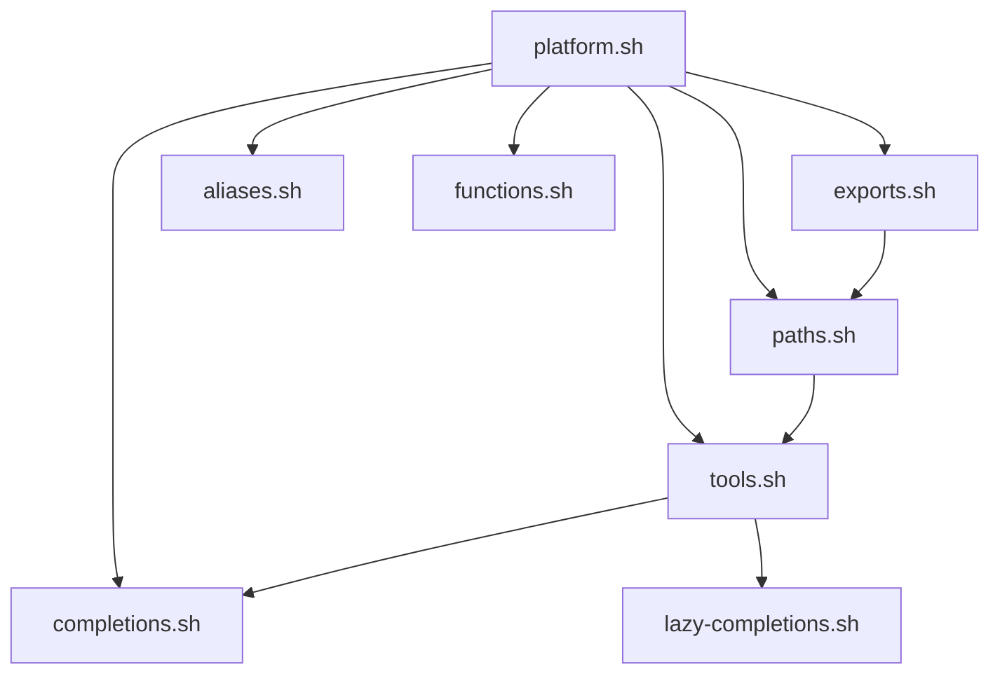
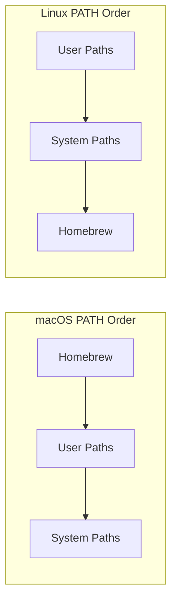
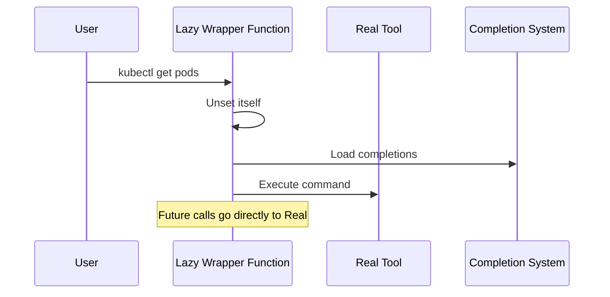

# Common Configuration System

This document provides a detailed breakdown of the `common/` directory, which contains the shared configuration system used by both bash and zsh across all supported platforms.

## Directory Structure

```
common/
  platform.sh         # Platform detection engine
  exports.sh          # Environment variables
  paths.sh            # PATH management
  aliases.sh          # Shell aliases
  functions.sh        # Utility functions
  tools.sh            # Tool detection and setup
  completions.sh      # Shell completion system
  lazy-completions.sh # Lazy-loaded completions
  macos/
    aliases.sh        # macOS-specific aliases
    functions.sh      # macOS-specific functions
  linux/
    aliases.sh        # Linux-specific aliases
```

## Module Dependency Graph



## Load Order

Modules are sourced in a specific order to ensure dependencies are available:

1. **platform.sh** - Must be first (provides detection functions)
2. **exports.sh** - Sets environment variables used by other modules
3. **paths.sh** - Configures PATH (depends on platform detection)
4. **aliases.sh** - Defines aliases (uses `has_command` from platform.sh)
5. **functions.sh** - Defines functions (uses platform detection)
6. **tools.sh** - Sets up tools (orchestrates completions and lazy loading)

## Module Details

### platform.sh - Platform Detection Engine

**Purpose**: Detects the operating system, architecture, package manager, and provides utility functions for platform-conditional logic.

**Key Functions**:

| Function                   | Description                     | Returns                                             |
| -------------------------- | ------------------------------- | --------------------------------------------------- |
| `detect_os()`              | Detects operating system        | `macos`, `debian`, `redhat`, `arch`, `wsl`, `linux` |
| `detect_arch()`            | Detects CPU architecture        | `x86_64`, `arm64`, `arm`                            |
| `detect_container()`       | Detects container environment   | `docker`, `kubernetes`, `wsl`, `none`               |
| `detect_package_manager()` | Detects package manager         | `homebrew`, `apt`, `dnf`, `pacman`, `zypper`        |
| `get_homebrew_path()`      | Gets Homebrew installation path | Path string                                         |
| `has_command()`            | Checks if command exists        | 0 (true) or 1 (false)                               |
| `is_macos()`               | Checks if running on macOS      | 0 or 1                                              |
| `is_linux()`               | Checks if running on Linux      | 0 or 1                                              |
| `is_wsl()`                 | Checks if running in WSL        | 0 or 1                                              |
| `is_ssh()`                 | Checks if connected via SSH     | 0 or 1                                              |

**Exported Variables**:

```bash
DOTFILES_OS          # Operating system identifier
DOTFILES_ARCH        # CPU architecture
DOTFILES_CONTAINER   # Container environment type
DOTFILES_PKG_MGR     # Package manager
DOTFILES_HOMEBREW_PATH  # Homebrew installation path
DOTFILES_COPY_CMD    # Clipboard copy command
DOTFILES_PASTE_CMD   # Clipboard paste command
DOTFILES_OPEN_CMD    # File/URL open command
```

**Auto-Initialization**: Runs `setup_platform_env()` automatically when sourced unless `DOTFILES_NO_AUTO_SETUP` is set.

---

### exports.sh - Environment Variables

**Purpose**: Sets up environment variables for XDG directories, editors, pagers, development tools, cloud providers, and privacy settings.

**Key Sections**:

| Section                 | Purpose                           |
| ----------------------- | --------------------------------- |
| Core Environment        | XDG Base Directory Specification  |
| Editor Configuration    | EDITOR, VISUAL, GIT_EDITOR        |
| Pager Configuration     | PAGER, MANPAGER, LESS options     |
| Terminal Configuration  | TERM, colors, WezTerm theme       |
| History Configuration   | Shell-specific history settings   |
| Language and Locale     | UTF-8 locale settings             |
| Development Environment | Go, Rust, Python, Node.js paths   |
| Cloud Provider Config   | AWS, GCP, Azure settings          |
| Kubernetes Config       | KUBECONFIG, KREW_ROOT, Helm paths |
| Security and Privacy    | Telemetry opt-outs, GPG TTY       |
| Tool-Specific Config    | FZF, ripgrep, bat, eza options    |

**Platform-Specific Exports**:

The module includes a `case` statement for platform-specific settings:

- **macOS**: Homebrew variables, Java home, compiler flags
- **Debian/Ubuntu**: DEBIAN_FRONTEND, Java home
- **RedHat/Fedora**: Java home
- **Arch**: Java home
- **WSL**: Windows interop settings, timezone fix

---

### paths.sh - PATH Management

**Purpose**: Builds and manages the PATH variable with platform-aware ordering and deduplication.

**Key Functions**:

| Function                    | Description                                       |
| --------------------------- | ------------------------------------------------- |
| `prepend_path()`            | Add directory to start of PATH                    |
| `append_path()`             | Add directory to end of PATH                      |
| `remove_from_path()`        | Remove directory from PATH                        |
| `force_path_front()`        | Force directory to front (remove first if exists) |
| `fix_homebrew_path_order()` | Fix PATH order after macOS path_helper            |
| `setup_homebrew_paths()`    | Configure Homebrew-related paths                  |
| `setup_system_paths()`      | Configure system paths                            |
| `setup_user_paths()`        | Configure user bin directories                    |
| `setup_dev_tools_paths()`   | Configure development tool paths                  |
| `cleanup_path()`            | Remove duplicate PATH entries                     |

**Platform-Aware PATH Ordering**:



- **macOS**: Homebrew paths come first (primary package manager for dev tools)
- **Linux**: System paths first (native packages take priority), Homebrew supplementary

**Language Environment Setup**:

| Function             | Purpose                              |
| -------------------- | ------------------------------------ |
| `setup_go_env()`     | Configure GOPATH, GOBIN, Go modules  |
| `setup_rust_env()`   | Source cargo/env                     |
| `setup_python_env()` | Configure Python paths, virtualenv   |
| `setup_node_env()`   | Handle NVM/mise conflicts, yarn/pnpm |

---

### aliases.sh - Shell Aliases

**Purpose**: Defines cross-platform shell aliases with smart fallbacks for modern tools.

**Key Categories**:

| Category        | Examples                                        |
| --------------- | ----------------------------------------------- |
| Navigation      | `..`, `...`, `~`, `-`, `dev`, `proj`            |
| File Operations | `ls`/`la`/`ll` (eza fallback), `mv`, `cp`, `rm` |
| Git             | `g`, `gs`, `ga`, `gc`, `gp`, `gl`, `groot`      |
| Docker          | `d`, `dc`, `dps`, `dcu`, `dcd`                  |
| Kubernetes      | `k`, `kg`, `kd`, `pods`, `svc`, `ns`            |
| Terraform       | `tf`, `tfi`, `tfp`, `tfa`                       |
| Tmux            | `tl`, `tks`, `tmr`, `td`                        |
| Network         | `myip`, `localip`, `ports`                      |
| Development     | `v`/`vi`/`vim`, `py`, `npi`, `nps`              |

**Smart Tool Detection**:

```bash
# Example: eza fallback to ls
if has_command eza; then
    alias ls="eza -lg --group-directories-first --color always --icons always"
else
    if is_macos; then
        alias ls="ls -G"
    else
        alias ls="ls --color=auto"
    fi
fi
```

**Platform-Specific Loading**:

At the end, the module sources platform-specific aliases:

```bash
if [[ -f "$SCRIPT_DIR/$DOTFILES_OS/aliases.sh" ]]; then
    source "$SCRIPT_DIR/$DOTFILES_OS/aliases.sh"
fi
```

---

### functions.sh - Utility Functions

**Purpose**: Provides cross-platform utility functions for common operations.

**Key Function Categories**:

| Category           | Functions                                                                      |
| ------------------ | ------------------------------------------------------------------------------ |
| Directory/File Ops | `mkd`, `mkf`, `f`, `fd_dir`, `cdf`, `filesize`                                 |
| Archive Operations | `extract`, `archive`                                                           |
| Text Processing    | `json`, `urlencode`, `urldecode`, `b64encode`, `b64decode`                     |
| Network            | `httpcompression`, `httpstatus`, `httpheaders`, `portscan`, `myips`, `dig_all` |
| Git                | `git_log_github`, `gitclone`, `gitexport`, `gitclean`                          |
| Process Management | `killall_name`, `killport`, `whoisport`                                        |
| Development        | `serve`, `genpass`, `qr`                                                       |
| System Info        | `sysinfo`, `needreboot`                                                        |
| Docker             | `docker-clean`, `op-dc-up`, `op-dc-down`, `dsh`                                |
| Clipboard          | `clip`, `unclip`, `copypath`                                                   |
| Tmux               | `fix_tmux_path`, `tmux_session`, `ta`, `ts`, `tk`                              |

**Example Function (extract)**:

```bash
extract() {
    case "$1" in
        *.tar.bz2|*.tbz2) tar xjf "$fullpath" ;;
        *.tar.gz|*.tgz)   tar xzf "$fullpath" ;;
        *.tar.xz|*.txz)   tar Jxf "$fullpath" ;;
        *.zip)            unzip -q "$fullpath" ;;
        *.rar)            unrar x "$fullpath" ;;
        *.7z)             7z x "$fullpath" ;;
        # ... more formats
    esac
}
```

---

### tools.sh - Tool Detection and Setup

**Purpose**: Detects installed tools, configures version managers, and sets up shell enhancements.

**Key Functions**:

| Function                      | Purpose                            |
| ----------------------------- | ---------------------------------- |
| `tool_exists()`               | Check if tool is installed         |
| `tool_version()`              | Get tool version                   |
| `tool_health()`               | Check tool health status           |
| `install_tool()`              | Install tool via package manager   |
| `setup_fzf()`                 | Configure FZF key bindings         |
| `setup_zoxide()`              | Initialize smart directory jumping |
| `setup_mise()`                | Initialize mise version manager    |
| `setup_modern_alternatives()` | Configure eza, bat, ripgrep, delta |
| `setup_autosuggestions()`     | Load zsh-autosuggestions           |
| `setup_syntax_highlighting()` | Load zsh-syntax-highlighting       |
| `system_health()`             | Run full system health check       |

**Tool Categories (Associative Arrays)**:

```bash
MODERN_TOOLS   # eza, bat, rg, fd, fzf, zoxide, delta, tldr, htop, ncdu, direnv, atuin
DEV_TOOLS      # git, nvim, tmux, jq, yq, curl, wget, tree, branchlet, opencode
CLOUD_TOOLS    # docker, kubectl, helm, terraform, ansible, aws, gcloud, az
LANG_TOOLS     # node, npm, yarn, python3, pip3, go, rust, cargo
```

**Version Manager Setup**:

The module uses `mise` as the primary version manager (replacing NVM):

```bash
setup_mise() {
    if command -v mise &>/dev/null; then
        eval "$(mise activate $SHELL_TYPE)"
    fi
}
```

---

### completions.sh - Shell Completion System

**Purpose**: Sets up shell completions for 50+ tools across cloud providers, Kubernetes, development tools, and modern CLI utilities.

**Completion Categories**:

| Category        | Tools                                                         |
| --------------- | ------------------------------------------------------------- |
| Kubernetes      | kubectl, helm, k9s, istioctl, kubens, kubectx                 |
| Cloud Providers | aws, gcloud, az, cdk, eksctl, sam                             |
| IaC             | terraform, terragrunt, packer, vault, consul, pulumi, ansible |
| Containers      | docker, docker-compose, podman, buildah, skopeo               |
| Git             | git, gh, glab, hub, git-lfs                                   |
| Languages       | npm, yarn, pnpm, deno, bun, pip, pipenv, poetry, cargo        |
| Modern CLI      | rg, fd, bat, eza, starship, delta, tldr                       |
| Security        | op (1Password), bw, bws                                       |

**Shell-Specific Behavior**:

- **Zsh**: Loads all completions eagerly (compinit handles it well)
- **Bash**: Only loads lightweight completions; heavy ones are lazy-loaded

---

### lazy-completions.sh - Lazy Loading System

**Purpose**: Implements lazy loading for expensive completions (kubectl, docker, helm, terraform, aws, gcloud) to improve shell startup time.

**Design Pattern**:



**Lazy-Loaded Tools**:

| Tool      | State Variable          |
| --------- | ----------------------- |
| kubectl   | `LAZY_LOADED_KUBECTL`   |
| docker    | `LAZY_LOADED_DOCKER`    |
| helm      | `LAZY_LOADED_HELM`      |
| carapace  | `LAZY_LOADED_CARAPACE`  |
| aws       | `LAZY_LOADED_AWS`       |
| gcloud    | `LAZY_LOADED_GCLOUD`    |
| terraform | `LAZY_LOADED_TERRAFORM` |

**Debugging Functions**:

```bash
force_load_all_completions  # Force-load all lazy completions
lazy_completion_status      # Show which completions are loaded
```

---

## Platform-Specific Extensions

### macos/aliases.sh

Provides macOS-specific aliases for:

- System management (flushdns, cpuinfo)
- Application launching (safari, chrome, code, xcode)
- Finder controls (showfiles, hidefiles, showdesktop)
- Dock management (dockrestart, dockspacer)
- Audio controls (mute, unmute, maxvol)
- Networking (airport, wifiscan, wifioff)
- Homebrew shortcuts (brewup, brewinfo, brewdeps)
- Time Machine (tmstatus, tmstart, tmstop)
- Spotlight (spotoff, spoton, reindex)

### macos/functions.sh

Provides macOS-specific functions for:

- System information (`macos_info`, `checkupdates`, `installUpdates`)
- Application management (`killapp`, `launch`, `appinfo`)
- Finder operations (`showfinder`, `finderselection`)
- Dock management (`dock_add`, `dock_remove`, `dock_spacer`)
- Screenshots (`screenshot`, `screenshotclip`)
- Audio controls (`vol`, `mute_toggle`)
- WiFi management (`wifi_status`, `wifi_connect`, `wifi_scan`)
- Battery information (`battery`, `battery_info`)
- Keychain access (`keychain_find`, `keychain_get`)

### linux/aliases.sh

Provides Linux-specific aliases for:

- Package management (apt, dnf, pacman, zypper, flatpak, snap)
- SystemD service management (start, stop, restart, enable)
- Process monitoring (psg, pstree, cpuinfo, meminfo)
- Network management (interfaces, ipaddr, wifi, wifilist)
- Firewall (ufw, iptables)
- Container tools (podman)
- Build tools (gcc, g++, make)
- Kernel management (modules, loadmodule)

## Disabling Auto-Initialization

Each module can be disabled by setting environment variables:

| Variable                       | Effect                            |
| ------------------------------ | --------------------------------- |
| `DOTFILES_NO_AUTO_SETUP`       | Disable platform.sh auto-setup    |
| `DOTFILES_NO_AUTO_PATH_SETUP`  | Disable paths.sh auto-setup       |
| `DOTFILES_NO_AUTO_TOOL_SETUP`  | Disable tools.sh auto-setup       |
| `DOTFILES_NO_AUTO_COMPLETIONS` | Disable completions.sh auto-setup |
| `DOTFILES_NO_LAZY_COMPLETIONS` | Disable lazy-completions.sh       |

## Debugging

Enable debug mode for verbose output:

```bash
export DOTFILES_DEBUG=1
```

## See Also

- [Architecture Overview](overview.md) - High-level system architecture
- [Platform Detection](platform-detection.md) - Platform detection details
