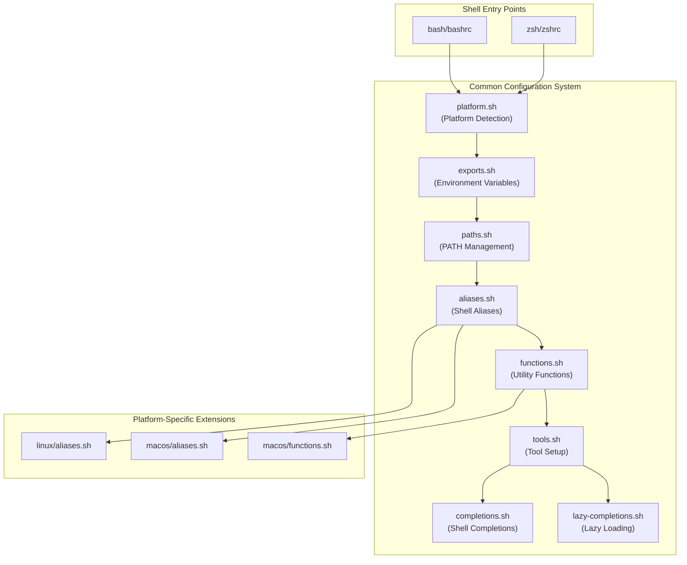
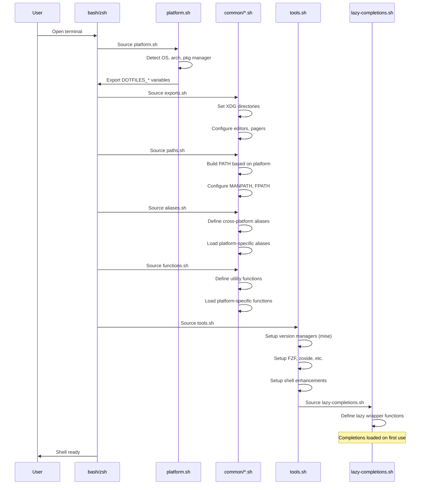
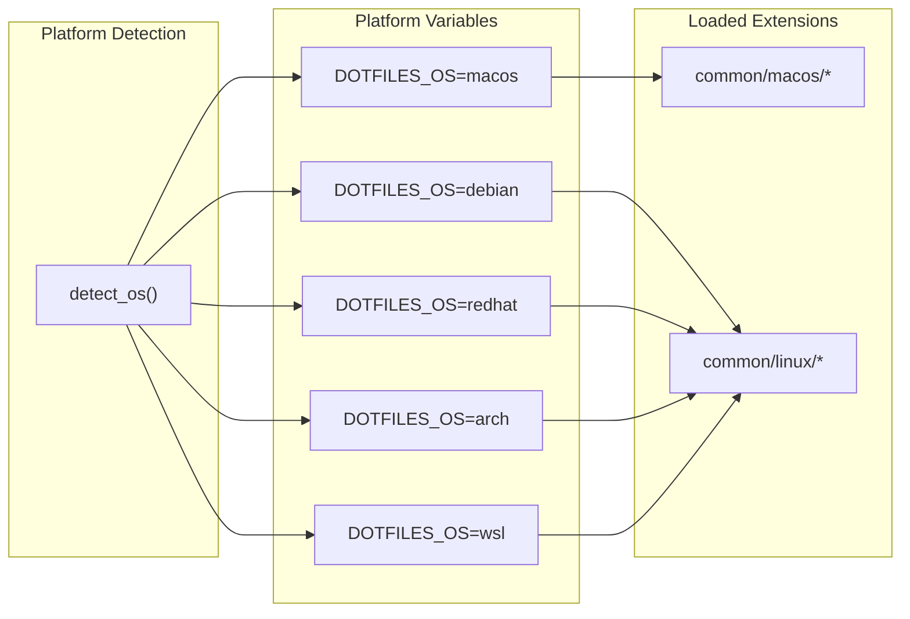
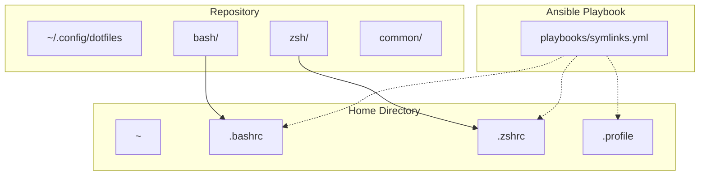

# Dotfiles System Architecture Overview

This document provides a high-level overview of the cross-platform dotfiles system architecture, explaining how the configuration system works and how different components interact.

## System Overview

The dotfiles repository implements a **unified cross-platform configuration system** that provides consistent shell behavior across macOS, Linux distributions (Ubuntu, Fedora, Arch, openSUSE), and WSL environments. The architecture is designed around a central `common/` directory that contains shared configurations, with shell-specific entry points (`bash/bashrc`, `zsh/zshrc`) that source these common modules.

### Key Design Principles

1. **Feature Parity**: Both bash and zsh shells have equivalent functionality
2. **Platform Awareness**: Automatic detection adapts behavior to the current OS
3. **Lazy Loading**: Heavy completions load on-demand for fast shell startup
4. **Modular Design**: Each concern (paths, aliases, functions) is separated into its own module
5. **Smart Fallbacks**: Graceful degradation when tools are not available

## Architecture Diagram



## Shell Initialization Flow

When a new shell session starts, the following sequence occurs:



## Component Relationships

### Core Components

| Component             | Purpose                                       | Dependencies            |
| --------------------- | --------------------------------------------- | ----------------------- |
| `platform.sh`         | Detects OS, architecture, and package manager | None (foundation)       |
| `exports.sh`          | Sets environment variables                    | platform.sh             |
| `paths.sh`            | Manages PATH and related variables            | platform.sh, exports.sh |
| `aliases.sh`          | Defines shell aliases                         | platform.sh             |
| `functions.sh`        | Defines utility functions                     | platform.sh             |
| `tools.sh`            | Sets up development tools                     | All common modules      |
| `completions.sh`      | Shell completion system                       | platform.sh             |
| `lazy-completions.sh` | Lazy-loaded heavy completions                 | None                    |

### Shell-Specific Entry Points

#### Bash (`bash/bashrc`)

```
bashrc
  |-- Guard: Check interactive shell
  |-- Guard: Prevent re-loading
  |-- Set DOTFILES_ROOT
  |-- Source common modules (platform, exports, paths, aliases, functions, tools)
  |-- Configure bash-specific options (shopt, bind)
  |-- Set up vi mode
  |-- Initialize Starship prompt
  |-- Load bash completion system
  |-- Initialize direnv, atuin
```

#### Zsh (`zsh/zshrc`)

```
zshrc
  |-- Set DOTFILES_ROOT
  |-- Source common modules (platform, exports, paths, aliases, functions, tools)
  |-- Configure zsh-specific options (setopt)
  |-- Set up vi mode with keybindings
  |-- Initialize completion system (compinit)
  |-- Load 1Password, AI tools configuration
  |-- Initialize Starship prompt
  |-- Initialize direnv, atuin
  |-- Final PATH cleanup and deduplication
```

## Platform-Specific Loading

The system automatically loads platform-specific configurations based on the detected operating system:



## Symlink Deployment

The dotfiles are deployed using Ansible to create symlinks from the repository to their expected locations:



## Key Directories

| Directory       | Purpose                              |
| --------------- | ------------------------------------ |
| `common/`       | Shared cross-platform configurations |
| `common/macos/` | macOS-specific aliases and functions |
| `common/linux/` | Linux-specific aliases and functions |
| `bash/`         | Bash-specific configurations         |
| `zsh/`          | Zsh-specific configurations          |
| `bin/`          | Utility scripts and installers       |
| `playbooks/`    | Ansible playbooks for deployment     |

## Environment Variables

The system exports several environment variables that other scripts can use:

| Variable                 | Purpose                     | Example Values                                |
| ------------------------ | --------------------------- | --------------------------------------------- |
| `DOTFILES_ROOT`          | Path to dotfiles repository | `~/.config/dotfiles`                          |
| `DOTFILES_OS`            | Detected operating system   | `macos`, `debian`, `arch`                     |
| `DOTFILES_ARCH`          | CPU architecture            | `x86_64`, `arm64`                             |
| `DOTFILES_PKG_MGR`       | Package manager             | `homebrew`, `apt`, `pacman`                   |
| `DOTFILES_HOMEBREW_PATH` | Homebrew installation path  | `/opt/homebrew`, `/home/linuxbrew/.linuxbrew` |
| `DOTFILES_IS_SSH`        | Running over SSH            | `true`, `false`                               |
| `DOTFILES_COPY_CMD`      | Clipboard copy command      | `pbcopy`, `xclip`                             |

## See Also

- [Common System Deep Dive](common-system.md) - Detailed documentation of each common module
- [Platform Detection](platform-detection.md) - How platform detection works
- [CLAUDE.md](/CLAUDE.md) - Developer-focused technical documentation
