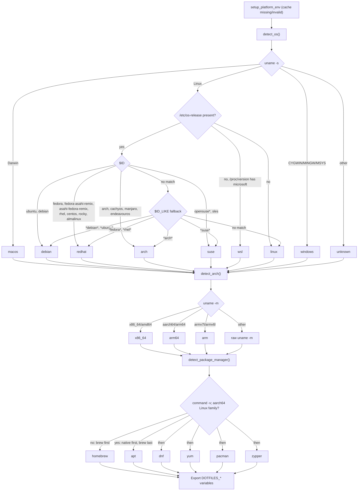

# Platform Detection System

This document describes how the dotfiles platform detection system works, including OS detection, architecture detection, package manager detection, and the utility functions available for platform-conditional logic.

## Overview

There are **two** detectors, but only one source of truth:

- The **canonical** Go detector in `internal/platform`, which every `dotf` subcommand uses. `dotf platform --write` renders its result to the platform env cache (`${XDG_CACHE_HOME:-$HOME/.cache}/dotfiles/platform.env`, see [the env cache contract](#platform-env-cache---env----write)), and `dotf apply`/`dotf link` refresh that cache after every successful run.
- The **shell fallback** in `common/platform.sh`. At bash/zsh startup `setup_platform_env` loads the cache (strictly validated, never sourced). Only when the cache fails validation, or is missing and `dotf platform --write` cannot create it, do its `detect_*` functions run and export the same `DOTFILES_*` variables.

The Go detector owns the vocabulary — the OS/arch/package-manager/container token sets — and the detection rules. The shell `detect_*` functions reproduce them so a host without `dotf` still agrees with one that has it. **A detection change lands in Go first; mirror it into the shell fallback in the same change.** The one known, accepted gap is `brew` resolution through shell functions/aliases (see [`detectPkgMgr`](#detectpkgmgr)).

## Part 1 — Canonical Go detector (`internal/platform`)

### `Detect(r exec.Runner) Info`

`Detect` scans `/etc/os-release` **once** per run and returns the full `Info` record. Detection degrades gracefully to the `unknown`/zero-value vocabulary on any failure — it never panics.

| `Info` field | Type        | Source                                                           | Notes                                                                             |
| ------------ | ----------- | ---------------------------------------------------------------- | --------------------------------------------------------------------------------- |
| `OS`         | `OS`        | `detectOSFrom` (`uname -s` + os-release)                         | `macos`, `debian`, `redhat`, `arch`, `suse`, `linux`, `wsl`, `windows`, `unknown` |
| `Arch`       | `Arch`      | `detectArch` (`uname -m`)                                        | Typed string, not a closed enum — unrecognized values carry through raw           |
| `PkgMgr`     | `PkgMgr`    | `detectPkgMgr(r, os, arch)`                                      | `homebrew`, `apt`, `dnf`, `yum`, `pacman`, `zypper`, `unknown`                    |
| `Container`  | `Container` | `detectContainer`                                                | `docker`, `kubernetes`, `wsl`, `none`                                             |
| `Distro`     | `string`    | os-release `ID`, unmapped                                        | `"unknown"` when os-release is missing or defines no `ID`                         |
| `Codename`   | `string`    | os-release `VERSION_CODENAME`, falling back to `UBUNTU_CODENAME` | e.g. `noble`. Empty on non-Debian-family hosts and macOS                          |
| `VersionID`  | `string`    | os-release `VERSION_ID`, raw                                     | e.g. `42` on Fedora 42, `24.04` on Ubuntu. Empty on rolling distros that set none |

`Codename` and `VersionID` are populated but deliberately **not** printed by `dotf platform` — see [the output contract](#dotf-platform-output-contract).

### `detectOS`

`detectOS` resolves the kernel name via `unameS(r)` and dispatches on its prefix.

| `uname -s` prefix         | Result                           |
| ------------------------- | -------------------------------- |
| `Darwin`                  | `OSMacOS` (`macos`)              |
| `Linux`                   | delegated to `detectLinuxFamily` |
| `CYGWIN`, `MINGW`, `MSYS` | `OSWindows` (`windows`)          |
| anything else             | `OSUnknown` (`unknown`)          |

`unameS` runs `uname -s` through the injected `exec.Runner`. If the command errors — a minimal or sandboxed host with no `uname` — it falls back to a `runtime.GOOS`-derived equivalent so detection still yields a usable value instead of panicking:

| `runtime.GOOS` | Fallback `uname -s` value |
| -------------- | ------------------------- |
| `darwin`       | `Darwin`                  |
| `linux`        | `Linux`                   |
| `windows`      | `MSYS`                    |
| anything else  | `""` (→ `unknown`)        |

`detectOS` is the path-taking seam the tests drive; `Detect` scans os-release once and calls `detectOSFrom` with the already-scanned record.

### `detectLinuxFamily`

| Condition                                                           | Result                        |
| ------------------------------------------------------------------- | ----------------------------- |
| `/etc/os-release` present                                           | `osFamilyFromID(ID, ID_LIKE)` |
| absent, and `/proc/version` contains `microsoft` (case-insensitive) | `OSWSL` (`wsl`)               |
| absent, and no `microsoft` marker                                   | `OSLinux` (`linux`)           |

Presence is the `os-release` file existing, mirroring the shell's `[[ -f /etc/os-release ]]` test — that is what distinguishes a missing file (the WSL/generic-linux fallback) from a present-but-empty one. A read error degrades to an empty record rather than partial results.

### `osFamilyFromID`

The `ID` field is checked **first**, against exact literals:

| Family constant | Value    | Accepted `ID` literals                                                                           |
| --------------- | -------- | ------------------------------------------------------------------------------------------------ |
| `OSDebian`      | `debian` | `ubuntu`, `debian`                                                                               |
| `OSRedHat`      | `redhat` | `fedora`, `fedora-asahi-remix`, `asahi-fedora-remix`, `rhel`, `centos`, `rocky`, `almalinux`     |
| `OSArch`        | `arch`   | `arch`, `cachyos`, `manjaro`, `endeavouros`                                                      |
| `OSSUSE`        | `suse`   | `sles`, plus **any** `ID` with the `opensuse` prefix (`opensuse-tumbleweed`, `opensuse-leap`, …) |

Only if no `ID` literal matches does the `ID_LIKE` fallback run, as a substring test:

| `ID_LIKE` contains   | Result     |
| -------------------- | ---------- |
| `debian` or `ubuntu` | `OSDebian` |
| `fedora` or `rhel`   | `OSRedHat` |
| `arch`               | `OSArch`   |
| `suse`               | `OSSUSE`   |
| none of the above    | `OSLinux`  |

This is what makes an unlisted derivative resolve to its parent family rather than to the bare `linux` fallback.

### `detectArch`

`detectArch` maps `unameM(r)` through `archFromUname`. `unameM` mirrors `unameS`'s fallback pattern: on a `uname -m` error it returns `runtime.GOARCH`.

| `uname -m`         | `Arch`                   |
| ------------------ | ------------------------ |
| `x86_64`, `amd64`  | `ArchX86_64` (`x86_64`)  |
| `aarch64`, `arm64` | `ArchARM64` (`arm64`)    |
| `armv7l`, `armv6l` | `ArchARM` (`arm`)        |
| anything else      | the raw value, unchanged |

The passthrough default is deliberate and mirrors the shell exactly: an unrecognized architecture is not coerced to a sentinel.

### `detectPkgMgr`

`detectPkgMgr(r, os, arch)` probes candidate binaries with the runner's `LookPath` and returns the first that resolves; `unknown` if none do. The probe **order** is host-dependent:

| Host                   | Probe order                                              |
| ---------------------- | -------------------------------------------------------- |
| macOS                  | `brew`, then `apt`, `dnf`, `yum`, `pacman`, `zypper`     |
| x86_64 Linux family    | `brew`, then `apt`, `dnf`, `yum`, `pacman`, `zypper`     |
| **arm64** Linux family | `apt`, `dnf`, `yum`, `pacman`, `zypper`, **then** `brew` |

On macOS Homebrew _is_ the package manager, so it is probed first. On x86_64 Linux it is still probed first, because `--homebrew=true` deliberately bootstraps linuxbrew and expects the packages phase to use it. On **aarch64 Linux the native manager wins instead**: Homebrew publishes no aarch64-Linux bottles at all, so an incidental linuxbrew install must not silently reroute every package away from the manifest's `dnf` names. Linuxbrew is still selected there when no native manager is present.

The shell fallback `common/platform.sh:detect_package_manager` uses the same host-dependent ordering. One residual difference is carried from the source: the shell checks `command -v brew`, which also resolves shell functions and aliases. `LookPath` (like Go's `exec.LookPath`) resolves only executables on `PATH`. The two therefore diverge in the edge case of a `brew` shim defined as a shell function or alias with no corresponding `PATH` binary.

### `detectContainer`

| Check (in order)                                            | Result                               |
| ----------------------------------------------------------- | ------------------------------------ |
| `/.dockerenv` exists, or `/proc/1/cgroup` mentions `docker` | `ContainerDocker` (`docker`)         |
| `KUBERNETES_SERVICE_HOST` is set                            | `ContainerKubernetes` (`kubernetes`) |
| `WSL_DISTRO_NAME` or `WSL_INTEROP` is set                   | `ContainerWSL` (`wsl`)               |
| otherwise                                                   | `ContainerNone` (`none`)             |

A missing or unreadable `/proc/1/cgroup` yields `false` rather than an error.

### Two Linux-family predicates

There are two Linux-family predicates and they are **not** interchangeable:

| Predicate                                                  | Members                                                    | Consumers                                              |
| ---------------------------------------------------------- | ---------------------------------------------------------- | ------------------------------------------------------ |
| `platform.IsLinuxFamily` (exported)                        | `debian`, `redhat`, `arch`, `suse`, **`linux`**, `wsl`     | `internal/sysconfig`, `internal/snapper`, `dotf apply` |
| `internal/symlink`'s `isLinuxFamily` (private, `table.go`) | `debian`, `redhat`, `arch`, `suse`, `wsl` — **no** `linux` | `FacetLinux` and `FacetHyprland` faceting              |

The divergence is intentional. The exported predicate answers "does the single systemd-Linux configurer apply here", which the generic `linux` fallback satisfies. The symlink one mirrors the Ansible `is_linux_family` test (`os_family` in RedHat/Debian/Suse/Archlinux), which has no member for an unidentified Linux, so `FacetLinux` entries such as `.config/systemd/user/tmux.service` must resolve through the **local** predicate. That exclusion is pinned by a golden test row (`linux-on-generic-linux`, expecting `false`), so flipping it fails the suite rather than silently changing what gets linked.

### `dotf platform` output contract

With no flags, `cmd/dotf/platform.go` emits exactly one line, a machine-greppable analogue of the shell's `print_platform_info`:

```text
os=%s arch=%s pkg=%s container=%s distro=%s
```

A Fedora example, as measured in the `fedora` CI job against `fedora:latest`:

```text
os=redhat arch=x86_64 pkg=dnf container=docker distro=fedora
```

`Codename` and `VersionID` are deliberately **not** printed — they are consumed programmatically (`VersionID` is the `$releasever` the repo backend's `dnf_repo` templating uses), not surfaced on this line. The shape is anchored from both ends: `cmd/dotf/main_test.go` asserts the regexp `^os=\S+ arch=\S+ pkg=\S+ container=\S+ distro=\S+\n$`, and the Fedora CI smoke step (critical test #6) greps the same line on a real Fedora userspace. Adding a field breaks both.

### Platform env cache (`--env` / `--write`)

`dotf platform --env` prints the platform as shell export lines; `dotf platform --write` atomically writes the same content to `${XDG_CACHE_HOME:-$HOME/.cache}/dotfiles/platform.env` (`XDG_CACHE_HOME` honored only when absolute) and prints nothing on success; both flags together write and print. The file format is fixed — one header comment, then these keys in this order:

```text
# Generated by `dotf platform --write`; do not edit.
export DOTFILES_PLATFORM_SCHEMA=1
export DOTFILES_PLATFORM_HOST=<os.Hostname()>
export DOTFILES_OS=<os>
export DOTFILES_ARCH=<arch>
export DOTFILES_CONTAINER=<container>
export DOTFILES_PKG_MGR=<pkg>
export DOTFILES_DISTRO=<distro>
export DOTFILES_CODENAME=<codename, may be empty>
export DOTFILES_HOMEBREW_PATH=<homebrew prefix, may be empty>
```

- Every value must match `^[A-Za-z0-9._/+-]*$`; the Go renderer (`platform.EnvLines`) replaces any non-conforming value with the empty string, so the file is always unquoted and shell-safe.
- `DOTFILES_HOMEBREW_PATH` is `brew --prefix` when `brew` is on `PATH`, else `/opt/homebrew` (macOS arm64), `/usr/local` (other macOS), `/home/linuxbrew/.linuxbrew` (Linux family incl. WSL), else empty (`platform.HomebrewPrefix`).
- `platform.WriteEnvCache` creates the parent directory `0700`, refuses a symlinked parent or target, writes a `0600` temp file in the same directory, fsyncs, and renames it into place.
- `dotf apply` and `dotf link` refresh the cache after a successful non-dry-run, reusing their already-detected `Info`. A write failure is a single `dotf: warning:` line on stderr and never changes the exit code.
- The shell loader `_dotfiles_load_platform_cache` accepts the file only if it passes every check listed under [`_dotfiles_load_platform_cache`](#_dotfiles_load_platform_cache-file) in Part 2 (ownership, schema, host, arch, container, key/value whitelist). `internal/platform/env_test.go` (`TestEnvCache_ShellParity`) runs the real loader against a Go-rendered file and tampered variants to keep the two sides in lockstep.

## Part 2 — Shell loader and fallback (`common/platform.sh`)

### Startup order: `setup_platform_env`

The shell does not detect the platform itself when it can avoid it. `setup_platform_env` resolves the platform variables in this order:

1. `_dotfiles_load_platform_cache` reads `${XDG_CACHE_HOME:-$HOME/.cache}/dotfiles/platform.env` (`XDG_CACHE_HOME` is honored only when absolute), the file written by `dotf platform --write`. If it loads with `DOTFILES_PKG_MGR=homebrew` but an empty `DOTFILES_HOMEBREW_PATH` (Go blanked a prefix with unsafe characters), the prefix is recomputed with `get_homebrew_path`.
2. If the load fails because the file **does not exist**, `dotf` is on `PATH`, the current user owns `$HOME` (so `sudo` with the user's `HOME` never leaves a root-owned cache) and no `platform.env.attempted` marker exists, it runs `dotf platform --write` once (output discarded, failure ignored so `set -e` scripts that source `platform.sh` never abort) and retries the load. If that run leaves no file (an older `dotf` without `--write`, an unwritable or symlinked cache dir), it drops the `.attempted` marker so later shells skip the fork; any successful `--write`, `apply` or `link` removes the marker. A file that exists but fails validation never forks `dotf`; it goes straight to step 3.
3. If the load still fails, the shell `detect_*` functions below run as a fallback. They export the same `DOTFILES_OS`, `DOTFILES_ARCH`, `DOTFILES_CONTAINER`, `DOTFILES_PKG_MGR`, `DOTFILES_DISTRO`, `DOTFILES_CODENAME` and `DOTFILES_HOMEBREW_PATH`; `DOTFILES_PLATFORM_SCHEMA` and `DOTFILES_PLATFORM_HOST` are unset, so their presence means "came from dotf".

The SSH, OSC 52, clipboard/opener and XDG variables are then derived from the resolved platform variables, never by re-detecting.

#### `_dotfiles_load_platform_cache [file]`

The loader never `source`s or `eval`s the file and forks nothing (only `read`, parameter expansion and `case`), so it is cheap on every shell start and safe against a tampered file. It parses into locals and exports only when **all** of these hold; otherwise it returns 1 and exports nothing:

- the file is a regular file, not a symlink, and owned by the current user (`-O`);
- every non-blank, non-`#` line is `export KEY=VALUE`, `KEY` is one of the nine whitelisted keys, and no key repeats;
- every `VALUE` consists only of `A-Za-z0-9._/+-` (empty allowed) — quotes, spaces, `$`, backticks and `;` are rejected;
- all nine keys are present, `DOTFILES_PLATFORM_SCHEMA` is `1`, and `DOTFILES_PLATFORM_HOST` equals `${HOSTNAME:-${HOST:-}}` (so a cache in a shared NFS home is ignored on other hosts);
- the cached `DOTFILES_ARCH` matches the running shell's arch, read fork-free from bash `$HOSTTYPE` / zsh `$CPUTYPE` and normalized (`amd64`→`x86_64`, `aarch64`→`arm64`, `armv6l`/`armv7l`→`arm`) — so a Rosetta shell (`arch -x86_64 zsh`) ignores an arm64 cache; the check is skipped when the variable is unset or unrecognized;
- the cached `DOTFILES_CONTAINER` is not `none` while `/.dockerenv` or `/run/.containerenv` exists (a container sharing `$HOME` and hostname with its host).

### Fallback detection flow



### How `detect_os()` works

```bash
detect_os() {
    case "$(uname -s)" in
        Darwin*)
            echo "macos"
            ;;
        Linux*)
            if [[ -f /etc/os-release ]]; then
                . /etc/os-release
                case "$ID" in
                    ubuntu|debian) echo "debian" ;;
                    fedora|fedora-asahi-remix|asahi-fedora-remix|rhel|centos|rocky|almalinux) echo "redhat" ;;
                    arch|cachyos|manjaro|endeavouros) echo "arch" ;;
                    opensuse*|sles) echo "suse" ;;
                    *)
                        # Fallback: use ID_LIKE for unknown derivatives
                        case "${ID_LIKE:-}" in
                            *debian*|*ubuntu*) echo "debian" ;;
                            *fedora*|*rhel*) echo "redhat" ;;
                            *arch*) echo "arch" ;;
                            *suse*) echo "suse" ;;
                            *) echo "linux" ;;
                        esac
                        ;;
                esac
            elif [[ -f /proc/version ]] && grep -qi microsoft /proc/version; then
                echo "wsl"
            else
                echo "linux"
            fi
            ;;
        CYGWIN*|MINGW*|MSYS*)
            echo "windows"
            ;;
        *)
            echo "unknown"
            ;;
    esac
}
```

### Supported operating systems

| Return value | Operating system                                                      | Detection method                       |
| ------------ | --------------------------------------------------------------------- | -------------------------------------- |
| `macos`      | macOS (any version)                                                   | `uname -s` returns `Darwin`            |
| `debian`     | Ubuntu, Debian                                                        | `/etc/os-release` `ID` field [^idlike] |
| `redhat`     | Fedora (including Fedora Asahi Remix), RHEL, CentOS, Rocky, AlmaLinux | `/etc/os-release` `ID` field [^idlike] |
| `arch`       | Arch Linux, CachyOS, Manjaro, EndeavourOS                             | `/etc/os-release` `ID` field [^idlike] |
| `suse`       | openSUSE (any `opensuse*` variant), SLES                              | `/etc/os-release` `ID` field [^idlike] |
| `wsl`        | Windows Subsystem for Linux without os-release                        | `/proc/version` contains "microsoft"   |
| `linux`      | Other Linux distributions                                             | Fallback for unknown Linux             |
| `windows`    | Cygwin, MinGW, MSYS                                                   | `uname -s` pattern match               |
| `unknown`    | Unrecognized system                                                   | Default fallback                       |

[^idlike]: A distro whose `ID` is not listed still lands in the right family when its `ID_LIKE` names one — `*debian*`/`*ubuntu*`, `*fedora*`/`*rhel*`, `*arch*` or `*suse*`. `ID` is always checked first; `ID_LIKE` runs only when no `ID` literal matched.

### Per-OS module search path — `os_module_dirs()`

`os_module_dirs()` is the single source of truth for where `common/{aliases,exports,functions}.sh` look for their platform-specific siblings. Nothing else should build those paths by hand. It prints one relative directory name per line, **most generic first**:

| `DOTFILES_OS`                             | Printed lines                 |
| ----------------------------------------- | ----------------------------- |
| `macos`                                   | `macos`                       |
| `linux`                                   | `linux`                       |
| `debian`, `redhat`, `arch`, `suse`, `wsl` | `linux`, then the distro name |
| `windows`, `unknown`                      | nothing                       |

Each consumer sources the family file first and the distro overlay second, so an overlay **refines** the family file rather than shadowing it — a future `common/redhat/aliases.sh` would layer on top of `common/linux/aliases.sh`. Missing directories are simply skipped; only `common/macos/` and `common/linux/` exist today, and the overlay slot is real but unused.

### Other detection functions

| Function                   | Returns                                                        | Notes                                                                           |
| -------------------------- | -------------------------------------------------------------- | ------------------------------------------------------------------------------- |
| `get_distro_name()`        | raw `ID` from `/etc/os-release`, else `unknown`                | Unmapped; exported as `DOTFILES_DISTRO` on fallback                             |
| `get_distro_codename()`    | `VERSION_CODENAME`, else `UBUNTU_CODENAME`, else empty         | Exported as `DOTFILES_CODENAME` on fallback                                     |
| `detect_arch()`            | `x86_64`, `arm64`, `arm`, or raw `uname -m`                    | Same case statement as `archFromUname`, passthrough default included            |
| `detect_container()`       | `docker`, `kubernetes`, `wsl`, `none`                          | `/.dockerenv` or `/proc/1/cgroup`, then `KUBERNETES_SERVICE_HOST`, then `WSL_*` |
| `detect_package_manager()` | `homebrew`, `apt`, `dnf`, `yum`, `pacman`, `zypper`, `unknown` | Same host-dependent order as `detectPkgMgr`                                     |
| `get_homebrew_path()`      | Homebrew prefix, or empty                                      | `brew --prefix` when `brew` is on `PATH`; otherwise the table below             |

#### `detect_package_manager`

The shell fallback probes `command -v` in the same host-dependent order as [`detectPkgMgr`](#detectpkgmgr): the native managers (`apt`, `dnf`, `yum`, `pacman`, `zypper`) before `brew` on aarch64 Linux family hosts, `brew` first everywhere else.

#### Homebrew path detection

| OS                       | Architecture | Homebrew path                |
| ------------------------ | ------------ | ---------------------------- |
| macOS                    | arm64        | `/opt/homebrew`              |
| macOS                    | x86_64       | `/usr/local`                 |
| Linux family (incl. WSL) | any          | `/home/linuxbrew/.linuxbrew` |

### Utility functions

| Function                 | Purpose                   | Usage                                  |
| ------------------------ | ------------------------- | -------------------------------------- |
| `has_command <cmd>`      | Check if command exists   | `if has_command nvim; then ...`        |
| `has_file <path>`        | Check if file exists      | `if has_file ~/.config/tool; then ...` |
| `has_dir <path>`         | Check if directory exists | `if has_dir ~/projects; then ...`      |
| `get_command_path <cmd>` | Get full path to command  | `path=$(get_command_path nvim)`        |

### Platform check functions

| Function       | Returns true if...                                              | Example                                          |
| -------------- | --------------------------------------------------------------- | ------------------------------------------------ |
| `is_macos`     | `$DOTFILES_OS` is `macos`                                       | `if is_macos; then open .; fi`                   |
| `is_linux`     | `$DOTFILES_OS` is `debian`, `redhat`, `arch`, `suse` or `linux` | `if is_linux; then xdg-open .; fi`               |
| `is_wsl`       | `$DOTFILES_OS` is `wsl`, or `$DOTFILES_CONTAINER` is `wsl`      | `if is_wsl; then explorer.exe .; fi`             |
| `is_container` | `$DOTFILES_CONTAINER` is anything but `none`                    | `if is_container; then echo "containerized"; fi` |
| `is_arm64`     | `$DOTFILES_ARCH` is `arm64`                                     | `if is_arm64; then echo "Apple Silicon"; fi`     |
| `is_x86_64`    | `$DOTFILES_ARCH` is `x86_64`                                    | `if is_x86_64; then echo "Intel/AMD"; fi`        |
| `is_ssh`       | Connected via SSH                                               | `if is_ssh; then use_osc52_clipboard; fi`        |

The OS, container and architecture predicates read the variables `setup_platform_env` exported and
start no subshell. Only when a variable is unset or empty do they fall back to `detect_os`,
`detect_container` or `detect_arch`. They trust whatever value is exported, so with
`DOTFILES_NO_AUTO_SETUP=1` call `setup_platform_env` before the first predicate; otherwise a
value inherited from a parent process (a host shell, a distrobox) is believed as is.

Note that `is_linux` does **not** cover a bare `wsl` result — the same distinction the two Go predicates draw.

### SSH and OSC 52 clipboard detection

```bash
is_ssh() {
    [[ -n "${SSH_CLIENT:-}" ]] || [[ -n "${SSH_TTY:-}" ]] || [[ -n "${SSH_CONNECTION:-}" ]]
}

should_use_osc52() {
    if is_ssh; then
        case "${TERM_PROGRAM:-}" in
            iTerm.app|WezTerm|Alacritty|vscode) return 0 ;;
        esac
        case "${TERM:-}" in
            *256color|xterm*|screen*|tmux*|alacritty*|wezterm*) return 0 ;;
        esac
    fi
    return 1
}
```

OSC 52 lets a terminal copy to the _local_ clipboard over SSH, so it is gated on both an SSH session and a terminal known to support the escape sequence.

### PATH helper functions

| Function                         | Purpose                    | Example                          |
| -------------------------------- | -------------------------- | -------------------------------- |
| `add_to_path <dir> [start\|end]` | Add to PATH if not present | `add_to_path ~/.local/bin start` |
| `prepend_path <dir>`             | Add to start of PATH       | `prepend_path ~/.cargo/bin`      |
| `append_path <dir>`              | Add to end of PATH         | `append_path /opt/tools`         |

Both helpers no-op when the directory does not exist or is already on `PATH`.

### Platform-specific commands

WSL is recognized with `is_wsl` (OS `wsl` **or** container `wsl`), so a WSL distro whose `DOTFILES_OS` is its family (e.g. `debian`) still gets the Windows clipboard and opener. macOS is read from the exported `DOTFILES_OS`.

| Function              | macOS     | WSL (`is_wsl`)                 | Other (X11/Wayland)                                                                    |
| --------------------- | --------- | ------------------------------ | -------------------------------------------------------------------------------------- |
| `get_copy_command()`  | `pbcopy`  | `clip.exe`                     | `xclip -selection clipboard`, else `xsel --clipboard --input`, else `cat`              |
| `get_paste_command()` | `pbpaste` | `powershell.exe Get-Clipboard` | `xclip -selection clipboard -o`, else `xsel --clipboard --output`, else a stub message |
| `get_open_command()`  | `open`    | `explorer.exe`                 | `xdg-open`                                                                             |

### Exported variables reference

After `setup_platform_env()` runs, these variables are available:

| Variable                   | Description                    | Example values                 |
| -------------------------- | ------------------------------ | ------------------------------ |
| `DOTFILES_OS`              | Detected OS family             | `macos`, `debian`, `redhat`    |
| `DOTFILES_ARCH`            | CPU architecture               | `x86_64`, `arm64`              |
| `DOTFILES_CONTAINER`       | Container type if any          | `docker`, `kubernetes`, `none` |
| `DOTFILES_PKG_MGR`         | Primary package manager        | `homebrew`, `dnf`, `pacman`    |
| `DOTFILES_DISTRO`          | Raw os-release `ID`            | `ubuntu`, `fedora`, `unknown`  |
| `DOTFILES_CODENAME`        | Release codename (or empty)    | `noble`, `bookworm`            |
| `DOTFILES_HOMEBREW_PATH`   | Homebrew installation path     | `/opt/homebrew`                |
| `DOTFILES_PLATFORM_SCHEMA` | Cache schema (cache only)      | `1`                            |
| `DOTFILES_PLATFORM_HOST`   | Cache writer host (cache only) | `myhost`                       |
| `DOTFILES_IS_SSH`          | Running over SSH               | `true`, `false`                |
| `DOTFILES_USE_OSC52`       | Should use OSC 52 clipboard    | `true`, `false`                |
| `DOTFILES_COPY_CMD`        | Clipboard copy command         | `pbcopy`                       |
| `DOTFILES_PASTE_CMD`       | Clipboard paste command        | `pbpaste`                      |
| `DOTFILES_OPEN_CMD`        | File/URL opener                | `open`                         |

### XDG directory setup

`setup_platform_env()` also establishes the XDG Base Directory variables and creates the directories if they do not exist:

```bash
export XDG_CONFIG_HOME="${XDG_CONFIG_HOME:-$HOME/.config}"
export XDG_DATA_HOME="${XDG_DATA_HOME:-$HOME/.local/share}"
export XDG_CACHE_HOME="${XDG_CACHE_HOME:-$HOME/.cache}"
export XDG_STATE_HOME="${XDG_STATE_HOME:-$HOME/.local/state}"
```

### Disabling auto-initialization

Sourcing `common/platform.sh` calls `setup_platform_env` automatically. To prevent that:

```bash
export DOTFILES_NO_AUTO_SETUP=1
source ~/.config/dotfiles/common/platform.sh
# Now manually call setup_platform_env when ready
```

### Debugging platform detection

`print_platform_info` prints the human-readable form of every detection result:

```bash
print_platform_info
```

```text
Platform Information:
  OS: macos
  Architecture: arm64
  Container: none
  Package Manager: homebrew
  Homebrew Path: /opt/homebrew
  Copy Command: pbcopy
  Paste Command: pbpaste
  Open Command: open
```

Individual functions can be exercised directly, and compared against the Go side with `dotf platform` (and the cache it writes with `dotf platform --env`):

```bash
source ~/.config/dotfiles/common/platform.sh

echo "OS: $(detect_os)"
echo "Arch: $(detect_arch)"
echo "Container: $(detect_container)"
echo "Package Manager: $(detect_package_manager)"
echo "Module dirs: $(os_module_dirs | tr '\n' ' ')"

dotf platform
dotf platform --env
```

## Fedora family (including Fedora Asahi Remix)

Every candidate os-release `ID` for a Fedora-family host resolves to `redhat` / `platform.OSRedHat`, by one of two routes:

- The explicit `ID` case — `fedora`, `fedora-asahi-remix`, `asahi-fedora-remix`, `rhel`, `centos`, `rocky`, `almalinux`.
- The `ID_LIKE` fallback, for any remix or spin whose `ID` is unlisted but whose `ID_LIKE` contains `fedora` or `rhel`.

Both routes exist deliberately, so a remix that renames its `ID` between releases still lands in the right family.

The verbatim `ID` / `ID_LIKE` / `VARIANT_ID` of the target Asahi device are **not** asserted here: they are captured read-only in Step 0 of [the Fedora first-run checklist](../fedora-first-run.md), and the detection fixtures are transcribed from whatever that capture prints. Do not restate a device `ID` as fact from this page.

The remaining Fedora-family facts:

| Aspect                    | Value                                                                                                          |
| ------------------------- | -------------------------------------------------------------------------------------------------------------- |
| `DOTFILES_OS` / `Info.OS` | `redhat`                                                                                                       |
| Package manager           | `dnf` — which **is** dnf5 on Fedora 41 and later                                                               |
| `uname -m` (Asahi)        | `aarch64` → `Arch` `arm64` → release asset `dotf_linux_arm64.tar.gz`                                           |
| Homebrew                  | Publishes no aarch64-Linux bottles, which is why `detectPkgMgr` demotes `brew` below the native managers there |

The `dnf` install/upgrade/remove argv and the `rpm -q` query argv are **source-compatible across dnf4 and dnf5**, so the same command strings work whether the host resolves `dnf` to the dnf5 binary or to a dnf4 compatibility shim. Do not "fix" them to a version-specific form.

## See Also

- [Architecture Overview](overview.md) — high-level system architecture
- [Common System](common-system.md) — all common configuration modules
- [Testing](../development/testing.md) — how the detector's assertions are run
- [Fedora first-run checklist](../fedora-first-run.md) — device-captured os-release provenance
- `internal/platform/` — canonical Go detector (`platform.go`, `types.go`, `osrelease.go`)
- `common/platform.sh` — shell cache loader and `detect_*` fallback
